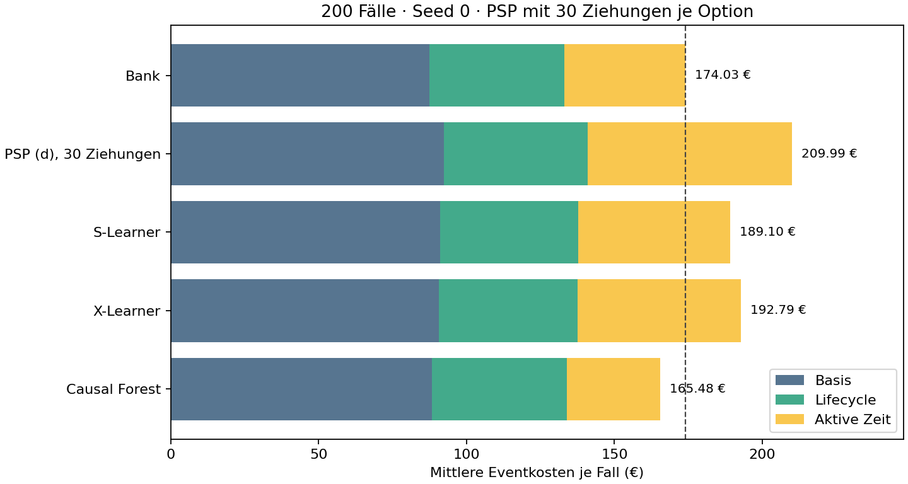

# EV-Vergleich nach Eventkosten

200 ausgewertete Fälle je Verfahren, Seed 0; 700 Warmup und 1.300 Cooldown. PSP (d): 30 Ziehungen je Option, Optionsabstand je Suffix gezogen. Die Tarife sind die gemeinsam festgehaltenen Beispielwerte aus event_costs.yaml.

| Verfahren | Kosten/Fall (€) | Ersparnis ggü. Bank (€) | Ersparnis (%) | Durchlaufzeit (Tage) |
|---|---:|---:|---:|---:|
| Bank | 174.03 | +0.00 | +0.00 | 19.41 |
| PSP (d), 30 Ziehungen | 209.99 | -35.96 | -20.66 | 19.95 |
| S-Learner | 189.10 | -15.07 | -8.66 | 20.30 |
| X-Learner | 192.79 | -18.77 | -10.78 | 18.74 |
| Causal Forest | 165.48 | +8.55 | +4.91 | 17.76 |

Niedrigere Kosten sind besser; positive Ersparnisse bedeuten Verbesserung gegenüber der Bank.

CATE-Training: 25,208 echte Fälle; 6,301 Fälle im äußeren Testsplit ausgeschlossen. S-Learner, X-Learner und Causal Forest verwenden dasselbe Kostenziel, dieselben Trainingsfälle und dieselben Wahlpunkte. PSP verwendet die vorhandenen trainierten Suffixgewichte.

Alle Verfahren werden auf denselben 200 Fall-IDs verglichen. Die tatsächlichen Eventfolgen ändern sich durch die Entscheidungen. Die Kosten stammen aus den Simulatorereignissen, nicht aus den Vorhersagen.

Ein Seed mit 200 Fällen ist ein Mini-Vergleich. Konfidenzintervalle über mehrere Seeds liegen hier nicht vor.

Die einzelnen Kosten und Entscheidungen stehen unter online/<policy>_seed0/. paired_case_costs.csv stellt die Kosten der gleichen Fälle nebeneinander.
